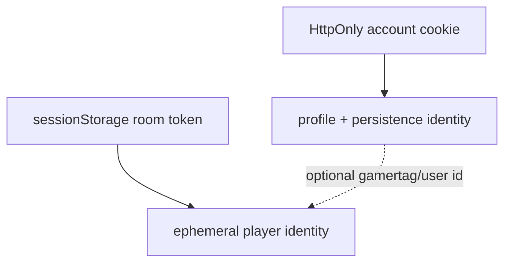

# ADR 0005: Separate opaque account and room sessions

**Status:** Accepted

**Decision:** Store only hashed random account-session tokens and deliver the raw
token in an HttpOnly cookie. Give each online-room player a separate opaque
resume token held in browser session storage.

**Consequences:** Room play does not require an account and scripts cannot read
account credentials; room tokens remain script-visible and are intentionally
short-lived with the room.

Login rechecks the stored credential after asynchronous passcode verification,
and profile writes compare the verified credential inside their transaction.
A concurrent password change therefore cannot be undone by an older profile
request or admit a login using the replaced passcode. Profile verification has
an account-level budget shared across rotated sessions and also consumes the
same address-level credential budget as login.

